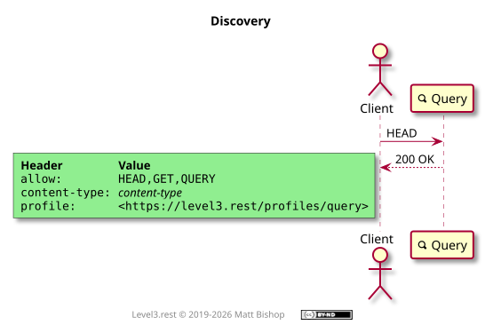
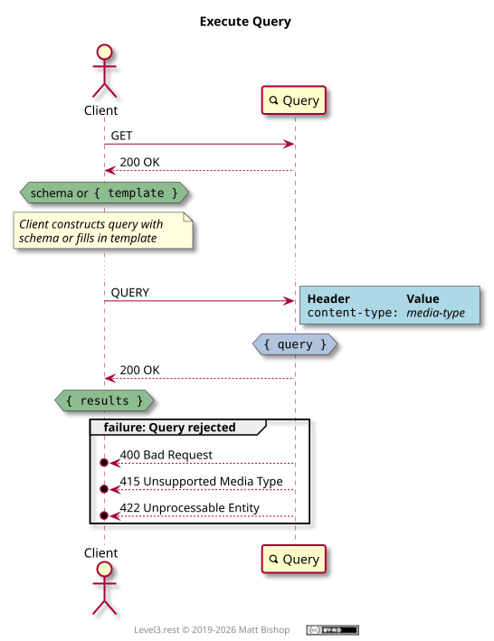

# Query Profile

```
profile: <https://level3.rest/profiles/query>
```

Query resources provide search and query affordances, returning information that matches a provided query form. Clients fill out a query object and then send it to the resource as a `QUERY` request. The resource analyzes the query object and returns information that matches.

Query differs from the Lookup profile in that Query returns data inside the response, whereas Lookup returns links to existing resources that match the search criteria. Naturally, the data in a Query result can include links to other resources, but its primary purpose is data retrieval.

##### Query Request

Query resources provide their query representation in two ways. One is to deliver a simple object template with fields that are either empty or pre-populated. The other is to provide a schema that the client uses to construct a payload to submit as a query. The client can learn the query representation format by reviewing the `content-type` header.

### Discovery

The Query profile presents the required `profile` and `allow` headers as well as a `content-type` header indicating the request payload type. The resource may provide a `content-type` like [`application/schema+json`](https://json-schema.org/latest/json-schema-core.html), [`application/prs.hal-forms+json`](https://rwcbook.github.io/hal-forms/) or [`application/xml-dtd`](https://www.w3.org/2006/02/son-of-3023/draft-murata-kohn-lilley-xml-04.html) that can be used to construct a query payload. The client must understand the content type and how to use the schema to produce a query payload.

Alternately, the Query can send a template object with empty fields, which is often a sufficient approach for simple searches. In this case the `Content-Type` will reflect the format of the template object, like `application/json` or `application/xml`.

{: .center-image}

### Query Execution

Query resources utilize the recent `QUERY` http method instead of the long-standing [POST/Redirect/GET](https://en.wikipedia.org/wiki/Post/Redirect/Get) design pattern to simplify the client’s query requests. Successful Query requests respond with the matching information. 

In order to determine how to submit a query, a client `GET`s the query representation from the Query resource. The representation could be a schema definition or a template object with empty fields. Both the schema and query template can include default values.

If the representation is a schema, then the client uses it to construct a query object. If the representation is a template object, then it should be filled in by the client. The completed object is then QUERYed back to the Query resource. If the submission was unacceptable, then the resource responds with a client error status code and error messages indicating the problem. Common problems include missing required fields or incorrect data in the fields.


##### Rejections

| Status Code                  | Explanation                                     |
|------------------------------|-------------------------------------------------|
| `404 Not Found`              | The query has no matching result.               |
| `400 Bad Request`            | The query’s body is malformed.                  |
| `415 Unsupported Media Type` | The media type in the request is not supported. |
| `422 Unprocessable Entity`   | The query is semantically incorrect.            |

{: .center-image}

## Specifications

HTTP QUERY Method: [RFC10008](https://www.rfc-editor.org/info/rfc10008/)

HTTP Extensions for WebDAV: [RFC 4918](https://tools.ietf.org/html/rfc4918)

- 422 Unprocessable Entity: [section 11.2](https://tools.ietf.org/html/rfc4918#section-11.2)

HTML 5.2: [Forms](https://www.w3.org/TR/html52/sec-forms.html)

HTTP/1.1 Semantics and Content: [RFC 7231](https://tools.ietf.org/html/rfc7231)

- `content-type`: [section 3.1.1.5](https://tools.ietf.org/html/rfc7231#section-3.1.1.5)
- 200 OK: [section 6.3.1](https://tools.ietf.org/html/rfc7231#section-6.3.1)
- 400 Bad Request: [section 6.5.1](https://tools.ietf.org/html/rfc7231#section-6.5.1)
- 404 Not Found: [section 6.5.4](https://tools.ietf.org/html/rfc7231#section-6.5.4)
- 415 Unsupported Media Type: [section 6.5.13](https://tools.ietf.org/html/rfc7231#section-6.5.13)
- 
